# MNIST ile MLP Tabanlı El Yazısı Rakam Tanıma
**Zeynep Özge Temel**

**Öğrenci No:** 23120205072

Bu projede MNIST el yazısı rakam veri seti üzerinde **yalnızca tam bağlantılı katmanlardan
oluşan bir Multi-Layer Perceptron (MLP)** sıfırdan eğitildi, farklı model yapılandırmaları
karşılaştırıldı ve model kendi el yazımla yazdığım öğrenci numaram üzerinde test edildi.

- Kütüphane: **PyTorch**. CNN ve hazır/önceden eğitilmiş model **kullanılmadı**.
- Tüm kod tek bir not defterinde: [`MNIST_MLP_Odev.ipynb`](MNIST_MLP_Odev.ipynb)
- Sonuçlar Google Colab'da (CPU) üretildi. Seed sabit (42).

## Depo içeriği

```
├── MNIST_MLP_Odev.ipynb   # Tüm kod ve çıktılar (veri, model, Deney 1, Deney 2, el yazısı)
├── el_yazisi/             # Kendi el yazımla öğrenci numaram (3 fotoğraf)
├── sonuclar/              # Grafikler, tablolar, işlenmiş 28x28 rakamlar
│   └── islenmis_28x28/    # Modele verilen 33 rakam görüntüsü
└── requirements.txt
```

**Çalıştırma:** [colab.research.google.com](https://colab.research.google.com) → Dosya → Not
defteri yükle → `MNIST_MLP_Odev.ipynb` → `OGRENCI_NO` değişkenine numarayı yaz →
Çalışma zamanı → Tümünü çalıştır. Fotoğraf yükleme düğmesi 6. bölümde çıkar.

---

## 1. Veri seti ve train / validation / test ayrımı

| Küme | Kaynak | Görüntü | Kullanım |
|---|---|---|---|
| **Train** | MNIST eğitim kümesinin 50.000'i | 50.000 | Ağırlıkların öğrenilmesi |
| **Validation** | MNIST eğitim kümesinin kalan 10.000'i | 10.000 | Her epoch sonunda ölçüm, en iyi epoch'un ve en iyi yapılandırmanın seçimi |
| **Test** | MNIST'in ayrı test kümesi | 10.000 | **Yalnızca en sonda**, nihai performans ölçümü |

- Görüntüler 28×28, gri seviyeli, 10 sınıf (0–9).
- Pikseller [0, 1] aralığına ölçeklendi, ardından **yalnızca train kümesinden hesaplanan**
  ortalama ve standart sapmayla standartlaştırıldı: `x = (x − 0.1306) / 0.3081`.
- **Test verisi model geliştirmede kullanılmadı:** en iyi epoch ve en iyi yapılandırma
  validation accuracy'ye göre seçildi; test accuracy bu kararlardan sonra hesaplandı.

---

## 2. Deney 1 – Temel MLP

```
28×28 → Flatten (784) → Linear(784,256) → ReLU → Linear(256,128) → ReLU → Linear(128,10)
```

| Hiperparametre | Değer |
|---|---|
| Gizli katmanlar | 2 katman: 256 ve 128 nöron |
| Aktivasyon | ReLU |
| Loss fonksiyonu | CrossEntropyLoss |
| Optimizer | Adam, learning rate = 0.001 |
| Batch size | 128 |
| Epoch | 20 |
| Dropout / veri artırma | yok |
| Parametre sayısı | 235.146 |

### Sonuçlar

| Metrik | Değer |
|---|---|
| Training loss (son epoch) | 0.0114 |
| Validation loss (son epoch) | 0.1106 (en düşük ≈ 0.082, epoch 5) |
| Training accuracy (son epoch) | %99.63 |
| Validation accuracy (en iyi) | **%98.09** (epoch 12) |
| **Test accuracy** | **%98.00** |
| Eğitim süresi | ≈ 46 sn (20 epoch, Colab CPU) |

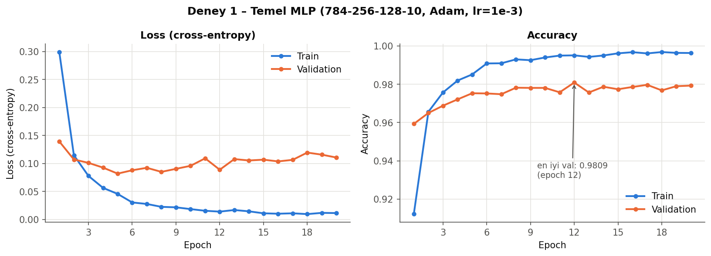

| Karışıklık matrisi (test) | Yanlış sınıflandırılan test örnekleri |
|---|---|
| 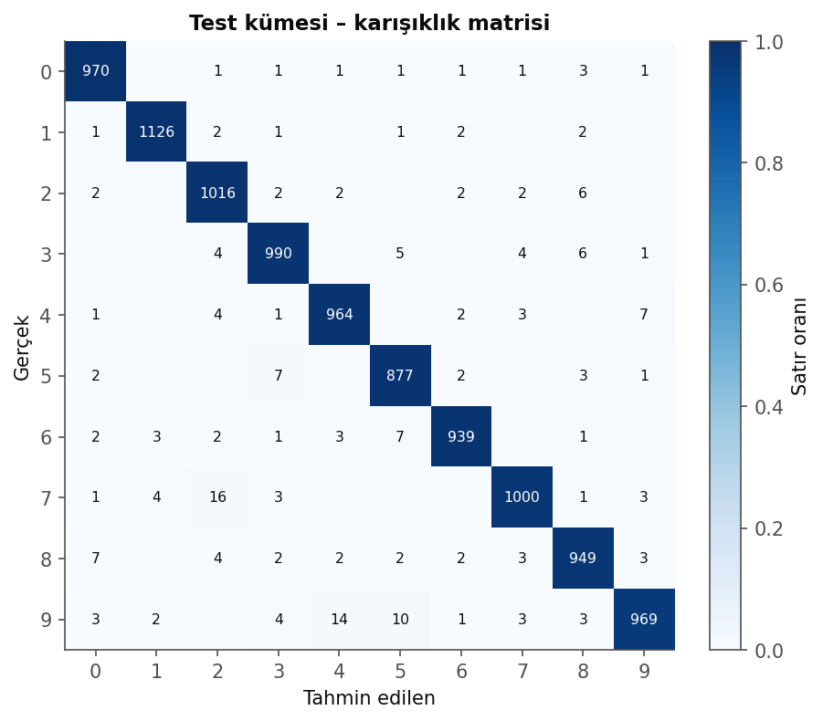 | 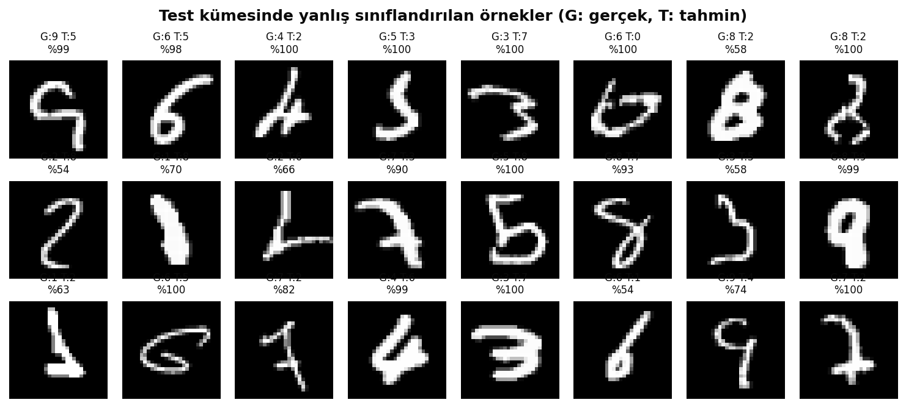 |

---

## 3. Deney 2 – Hiperparametre karşılaştırması

Temel modelden her seferinde **yalnızca bir şey** değiştirildi (20 epoch, seed 42).

| Yapılandırma | Değişen | Train loss | Val loss | Train acc | Val acc (en iyi) | **Test acc** | Süre (sn) |
|---|---|---:|---:|---:|---:|---:|---:|
| temel | – (256-128, Adam 1e-3, bs 128) | 0.0114 | 0.1106 | 0.9963 | 0.9809 | 0.9800 | 46.4 |
| dar_128-64 | gizli: 128-64 | 0.0075 | 0.1154 | 0.9973 | 0.9778 | 0.9773 | 27.5 |
| genis_512-256 | gizli: 512-256 | 0.0126 | 0.1027 | 0.9958 | 0.9822 | 0.9808 | 96.1 |
| derin_512-256-128-64 | 4 gizli katman | 0.0089 | 0.1092 | 0.9969 | 0.9807 | 0.9792 | 112.3 |
| sgd_lr0.01 | SGD, momentum yok | 0.1179 | 0.1362 | 0.9667 | 0.9593 | 0.9625 | 35.2 |
| sgd_mom0.9_lr0.01 | SGD + momentum 0.9 | 0.0024 | 0.0769 | 1.0000 | 0.9798 | 0.9806 | 37.3 |
| adam_lr1e-4 | lr = 0.0001 | 0.0363 | 0.0799 | 0.9906 | 0.9756 | 0.9775 | 43.2 |
| adam_lr1e-2 | lr = 0.01 | 0.0776 | 0.1958 | 0.9818 | 0.9729 | 0.9722 | 63.7 |
| batch_32 | batch size 32 | 0.0127 | 0.2089 | 0.9962 | 0.9797 | 0.9778 | 115.0 |
| batch_512 | batch size 512 | 0.0019 | 0.0874 | 0.9999 | 0.9809 | 0.9781 | 34.3 |
| dropout_0.3 | dropout 0.3 | 0.0386 | 0.0707 | 0.9873 | 0.9828 | 0.9810 | 63.5 |
| **genis_dropout0.2_augment** | 512-256 + dropout 0.2 + veri artırma | 0.0855 | **0.0451** | 0.9739 | **0.9898** | **0.9879** | 134.1 |

Veri artırma: her batch'te rastgele ±12° döndürme, %90–110 ölçekleme, ±2 piksel kaydırma.

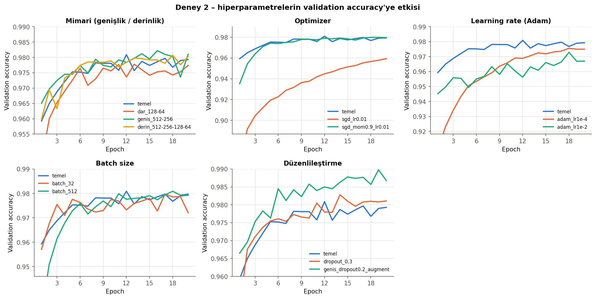
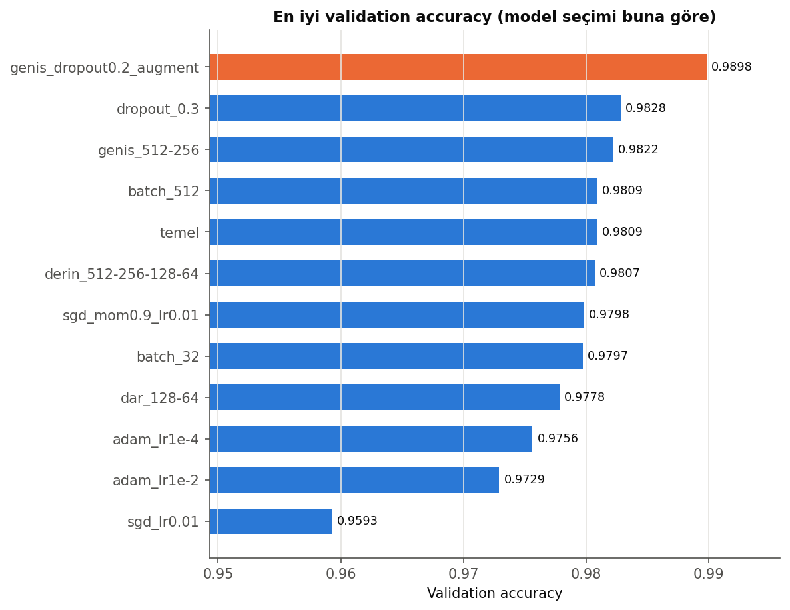
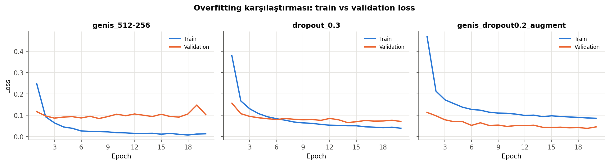

**Seçilen model:** `genis_dropout0.2_augment` (validation accuracy'ye göre en iyi: %98.98).

---

## 4. Kendi el yazımla öğrenci numaram

Numaramı (23120205072) üç farklı şekilde yazdım: kalın keçeli kalemle, ince kalemle
hızlı/eğik ve ince kalemle düzgün. Fotoğraflar: [`el_yazisi/`](el_yazisi/)

### Görüntülerin MNIST formatına getirilmesi

1. Gri tonlamaya çevirme
2. Aydınlatma düzeltme (kâğıdın gölgeleri ve ışık farkı giderilir)
3. Renk ters çevirme: siyah zemin, beyaz rakam (MNIST ile aynı)
4. Eşikleme: mürekkep kâğıttan ayrılır, küçük lekeler silinir
5. Rakamların otomatik ayrılması (soldan sağa 11 parça)
6. Her rakam için: çizgi kalınlığı MNIST'e benzetilir, en-boy oranı korunarak 20×20 kutuya
   sığdırılır, 28×28 çerçeveye yerleştirilir ve kütle merkezi ortalanır
7. Normalizasyon: [0, 1] ölçekleme + eğitimdeki `(x − mean) / std`

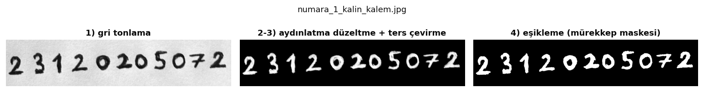

### Sonuçlar

| Fotoğraf | Temel model (Deney 1) | En iyi model (Deney 2) |
|---|---|---|
| numara_1 – kalın kalem | 11/11 | 11/11 |
| numara_2 – ince, hızlı | **10/11** (7. rakam "0" → "9" sanıldı, %61 güven) | 11/11 |
| numara_3 – ince, düzgün | 11/11 | 11/11 |
| **Toplam** | **32/33 = %97.0** | **33/33 = %100** |

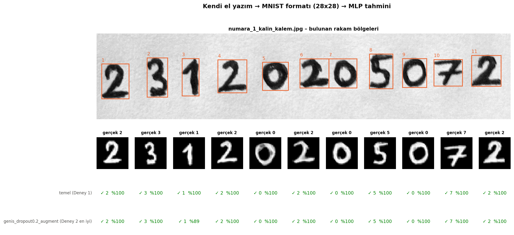
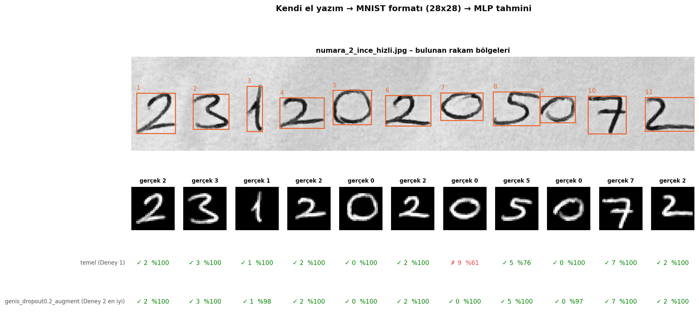
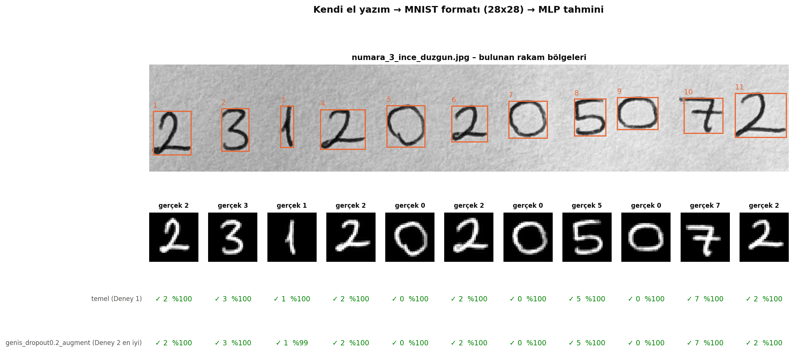

### Ön işlemenin etkisi (distribution shift)

Aynı modeller ve aynı 33 rakam; sadece ön işleme adımları tek tek kapatıldı:

| Ön işleme | Temel (Deney 1) | En iyi (Deney 2) |
|---|---|---|
| Tam ön işleme | 32/33 (%97) | 33/33 (%100) |
| Çizgi kalınlığı ayarı yok | 31/33 (%94) | 33/33 (%100) |
| 20×20 kutu + ortalama yok | 10/33 (%30) | 20/33 (%61) |
| Renk ters çevrilmemiş | 0/33 (%0) | 0/33 (%0) |

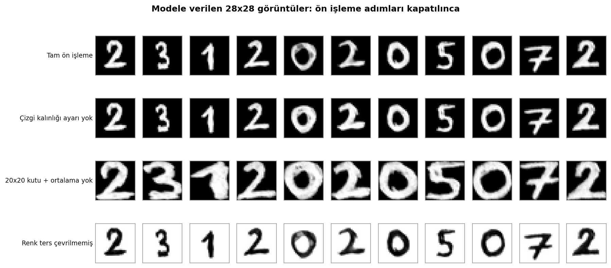
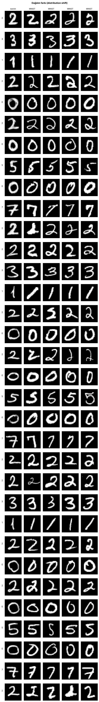

---

## 5. Genel değerlendirme

**Deney 1 – Overfitting.** Temel model test kümesinde %98.00 doğruluğa ulaştı. Ancak
grafiklerde açık bir overfitting görülüyor: training loss 20 epoch boyunca sürekli düşerek
0.011'e inerken, validation loss 5. epoch civarında en düşük değerine (≈0.082) ulaşıp
sonra yükselmeye başladı (son epoch'ta 0.111). Training accuracy %99.6'ya çıktı, validation
accuracy ise %97.5–98 bandında kaldı. Yani model 5–6. epoch'tan sonra genel kuralları
öğrenmeyi bırakıp train verisini ezberlemeye başladı. Bu yüzden son epoch yerine en iyi
validation accuracy'ye sahip epoch'un (12. epoch) ağırlıkları kullanıldı. Karışıklık
matrisine göre test kümesinde en sık hatalar birbirine şekilce benzeyen rakamlar arasında:
7 → 2 (16 kez), 9 → 4 (14 kez) ve 9 → 5 (10 kez). En düşük sınıf doğruluğu 9 rakamında
(%96.0), en yüksek 1 rakamında (%99.2).

**Deney 2 – Hiperparametrelerin etkisi.**
- *Learning rate ve optimizer* en kritik ayarlar oldu. Momentumsuz SGD 20 epoch'ta yalnızca
  %95.9'a ulaştı; momentum 0.9 eklenince %98.0'e çıkıp Adam'la aynı seviyeye geldi. Çok
  büyük learning rate (0.01) dalgalı bir eğitime ve en yüksek validation loss'lardan birine
  (0.196) yol açtı; çok küçük learning rate (0.0001) ise kararlı ama yavaş öğrendi.
- *Ağ boyutu* doğruluğu çok az değiştirdi (%97.8–98.2) ama süreyi ciddi artırdı: 4 katmanlı
  ağ temel modelden 2.4 kat daha uzun sürdü. Daha büyük ağ tek başına overfitting'i
  çözmedi.
- *Batch size* doğruluğa az, süreye çok etki etti: 32 ile 115 sn, 512 ile 34 sn. Küçük
  batch'te validation loss en yüksek değere (0.209) çıktı, yani overfitting daha belirgindi.
- *Düzenlileştirme* en faydalı değişiklik oldu. Dropout 0.3 validation loss'u 0.111'den
  0.071'e düşürdü. Dropout ile veri artırmanın birlikte kullanıldığı model en iyi sonucu
  verdi: validation %98.98, test **%98.79**. Bu modelde training accuracy'nin (%97.4)
  validation'dan düşük olması bir hata değil: training metrikleri dropout açıkken ve
  döndürülmüş/kaydırılmış (zorlaştırılmış) görüntüler üzerinde ölçülüyor.

**Train / validation / test.** Tüm kararlar (en iyi epoch, en iyi yapılandırma) validation
kümesiyle verildi, test kümesine yalnızca en sonda bakıldı. Test sonuçlarının validation
sonuçlarına çok yakın olması (en iyi modelde %98.98'e karşı %98.79) bu ayrımın doğru
çalıştığını ve model seçiminin validation kümesine aşırı uyum sağlamadığını gösteriyor.

**Kendi el yazım ve distribution shift.** Temel model kendi el yazımdaki 33 rakamın 32'sini
(%97), en iyi model ise 33'ünü de (%100) doğru tanıdı. Bu sonuç MNIST test doğruluğuna
yakın ve 33 gibi küçük bir örnekte beklenebilecek bir değer. Ancak bu başarı büyük ölçüde
ön işlemeden geliyor. Ön işleme adımları kapatıldığında aynı modellerin başarısı çarpıcı
biçimde düştü: rakamlar 20×20 kutuya sığdırılıp ortalanmadığında %30–61'e, renkler ters
çevrilmediğinde (beyaz zemin, siyah rakam) **%0'a** indi. Bunun nedeni, MLP'nin görüntüyü
784 bağımsız piksel olarak görmesi: model rakamın şeklini değil, "hangi piksel ne kadar
parlak" bilgisini öğreniyor. Rakam birkaç piksel kaydığında, büyüdüğünde ya da renkler
tersine döndüğünde girdi vektörü tamamen değişiyor ve model eğitimde gördüğü dağılımın
dışına çıkıyor. Bu, eğitim verisi ile gerçek dünya verisi arasındaki farkın
(distribution shift) en açık örneği.

Yaptığı tek hatada temel model, hızlı yazdığım yassı ve eğik "0"ı %61 güvenle "9" sandı.
MNIST'teki 0'lar genellikle dik ve yuvarlak olduğu için bu şekil eğitim verisinden
farklıydı. Aynı fotoğrafta "5"in güveni de %76'ya düştü. Veri artırmayla eğitilen model ise
bu rakamların hepsini doğru ve yüksek güvenle tanıdı, çünkü eğitimde döndürülmüş ve
kaydırılmış rakamlar görmüştü. Benzer şekilde MNIST'te az bulunan Avrupa yazım stilleri
(bayraklı "1", ortası çizgili "7") doğru tanındı; yalnızca kalın kalemle yazdığım bayraklı
"1"de en iyi modelin güveni %89'a düştü.

**Sonuç.** Basit bir MLP, MNIST'te %98–99 doğruluğa ulaşabiliyor ve doğru hazırlanmış
gerçek el yazısında da iyi çalışıyor. Ancak bu başarı, verinin eğitim verisine ne kadar
benzediğine güçlü biçimde bağlı. Uzamsal yapıyı kullanmayan bir MLP için ön işleme ve
veri artırma, gerçek dünyaya genelleme açısından model mimarisinden bile daha önemli.

*Not: Rakamları ayırırken kod, numaranın kaç haneli olduğunu (11) bilerek birbirine değen
rakamları bölüyor. Rakamların ne olduğu bilgisi kullanılmıyor; tüm tahminleri model yapıyor.*
